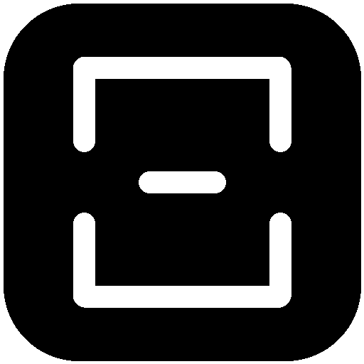
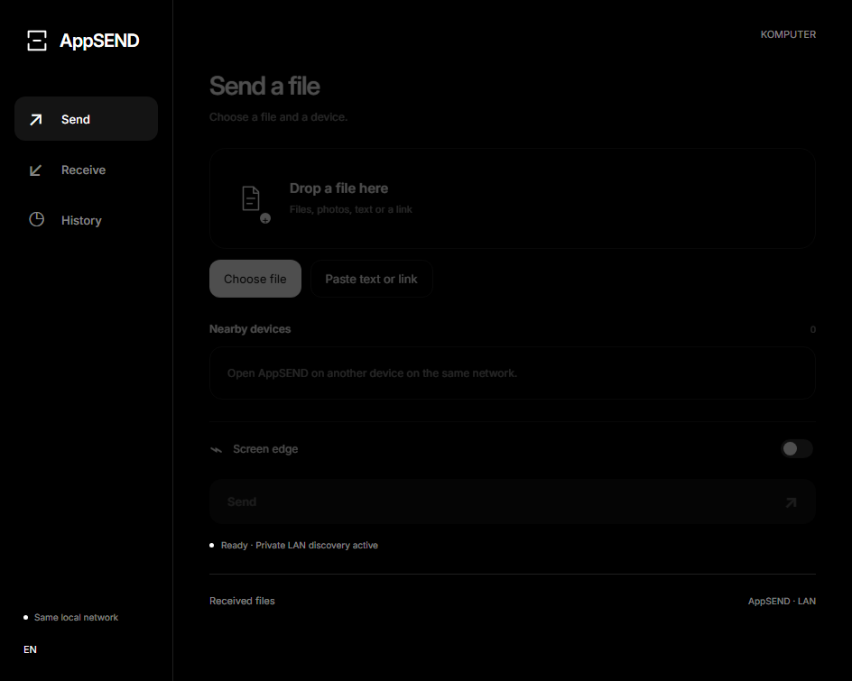

<p align="center">
  
</p>

<h1 align="center">AppSEND</h1>

<p align="center">
  <b>Fast, local, peer-to-peer file and text transfer between Android and Windows. Zero cloud. Zero accounts. Fully encrypted.</b>
</p>

<p align="center">
  
  
  
  
  
</p>

---

## Overview

**AppSEND** is an offline, peer-to-peer sharing tool that connects your Windows PC and Android phone over your local network. 

Traditional sharing tools often rely on external relay servers, online accounts, or bluetooth pairing hassles. AppSEND discovers devices over local IPv4 UDP broadcasts, establishes an ephemeral end-to-end encrypted channel, and streams files directly at full LAN speed.

<p align="center">
  
</p>

---

## ✨ Features

- **✋ Gesture Grab Transfer (Android → Windows)**: Select a file, point the phone camera at your hand, make a fist to grab the file, and release your palm to launch it straight to your PC. Powered by on-device Google MediaPipe vision models with zero frames stored or transmitted.
- **↗️ Card Swipe Throw**: Stage a file and flick the card upward with an organic fling animation that transfers directly to your desktop.
- **🖥️ Screen Edge Proximity**: Bring your phone top-down toward the monitor bezel or dock a file along the top desktop edge to trigger instant transfer.
- **🔒 True End-to-End Encryption**: Every session generates fresh ephemeral keys with mutual commitment nonces, HKDF-SHA256 derivation, and chunked AES-256-GCM authenticated payload streaming.
- **⚡ Automatic Receiving**: Incoming files arrive quietly in the background directly into `Downloads/AppSEND` (or Android private storage) without interrupting dialogs or focus-stealing popups.
- **🌐 100% Offline & Private**: No cloud servers, no Internet connection required, no telemetry, no tracking.
- **🇷🇺 / 🇬🇧 Bilingual**: Built-in support for Russian and English.

---

## 🎬 Interaction Modes

<div align="center">
  <table>
    <tr>
      <td align="center"><b>Screen Edge Transfer</b></td>
      <td align="center"><b>Card Throw Gesture</b></td>
    </tr>
    <tr>
      <td align="center"></td>
      <td align="center"></td>
    </tr>
  </table>
</div>

### 1. Gesture Grab Mode (Front Camera)
1. Pick a file on Android and select your Windows PC from the nearby devices.
2. Select **Grab** and tap **Send**.
3. Hold your hand in front of the front camera and **close your fist** — the card contracts with haptic feedback.
4. When prompted, **open your palm** — the file launches immediately to your computer.

### 2. Swipe Throw Mode
1. Pick a file, select your computer, choose **Throw**, and tap **Send**.
2. A dedicated throw card appears on screen.
3. Swipe the card upward (velocity or distance threshold) to send the file.

### 3. Screen Edge Mode
- **Phone**: Hover the phone upside-down near the top bezel of your monitor; proximity and gravity sensors trigger the transfer handshake.
- **Desktop**: Drag and drop any file directly onto the subtle strip along the top monitor edge or hold your cursor there for 700 ms.

---

## 🛠️ Project Structure

```text
AppSEND/
├── android/                   # Android native app (Kotlin, Jetpack Compose, CameraX)
│   ├── app/src/main/          # UI, gesture engine, network transport, cryptography
│   └── app/src/test/          # 43 Kotlin JVM unit & interop tests
├── desktop/                   # Windows desktop app (Electron, Node.js)
│   ├── main.cjs               # Electron main process & edge overlay window
│   ├── crypto.cjs             # WebCrypto / Node crypto implementations
│   ├── discovery.cjs          # UDP broadcast discovery engine
│   ├── engine.cjs             # WebSocket negotiation & encrypted HTTP streaming
│   ├── ui/                    # Sandboxed, context-isolated UI renderer
│   └── test/                  # Protocol & motion unit tests
├── protocol/                  # Shared wire protocol specification & test vectors
├── scripts/                   # Localization generators & firewall scripts
└── binaries/                  # Pre-built release binaries (Windows setup, Android APK)
```

---

## 🔐 Security & Protocol

AppSEND operates under an explicit local-trust threat model:

1. **Discovery**: Nodes announce their presence via UDP port `45871` every 2 seconds.
2. **Key Exchange**: Peer connections negotiate an ephemeral P-256 ECDH shared secret through a commit-before-reveal handshake on WebSocket `/control`, preventing key-manipulation attacks.
3. **Key Derivation**: 32-byte session keys derived using HKDF-SHA256 (`edgebeam/v1`).
4. **Transport**: Payloads are split into bounded chunks encrypted with AES-256-GCM using monotonic 64-bit sequence counters.
5. **Integrity**: Files are independently verified with an end-to-end SHA-256 checksum upon receipt before being committed to disk.
6. **Sandboxing**: Desktop renderers have Node integration disabled and enforce strict Content Security Policy (`script-src 'self'`).

For full details, see [`PROTOCOL.md`](PROTOCOL.md) and [`SECURITY.md`](SECURITY.md).

---

## 🚀 Building & Development

### Windows Desktop App

**Requirements:** Windows 10/11 x64, Node.js 20+ and npm.

```powershell
# Install dependencies
cd desktop
npm ci

# Launch development app
npm start

# Run protocol and motion tests
npm test

# Build 64-bit NSIS Windows installer
npm run dist
```

### Android App

**Requirements:** Android Studio with JDK 17, Android SDK Platform 35 (Android 8.0+ / API 26 minimum).

```powershell
# In PowerShell from the android directory:
$env:JAVA_HOME = "path/to/jdk-17"
$env:ANDROID_HOME = "path/to/android-sdk"

# Run unit tests and lint
.\gradlew.bat testDebugUnitTest lintDebug

# Assemble debug APK
.\gradlew.bat assembleDebug
```

Output APK will be generated at `android/app/build/outputs/apk/debug/app-debug.apk`.

---

## 🧪 Testing & Validation

The codebase includes comprehensive unit tests verifying both platforms independently and against each other:
- **Desktop**: 16/16 tests passing (framing, discovery, crypto vectors, engine state machine).
- **Android**: 43/43 tests passing (grab posture recognition, approach sensor gating, crypto parity with Node.js, and live interop engine over local socket loops).

See [`VALIDATION.md`](VALIDATION.md) for full test metrics.

---

## 📄 License

This project is open-source under the [MIT License](LICENSE).
Inter font is licensed under the [SIL Open Font License (OFL)](desktop/assets/OFL.txt).
